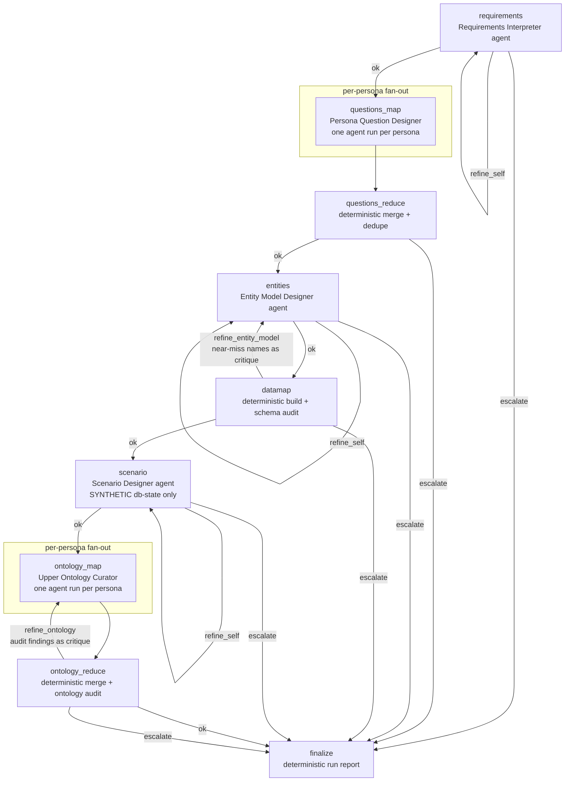
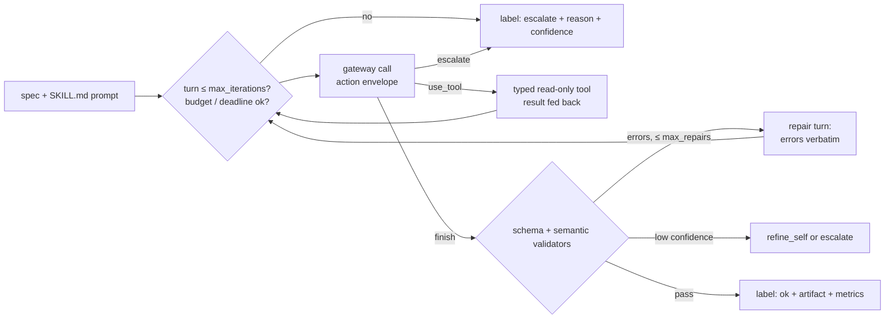

# RAIN — agentic skills platform

Two pipelines run on one shared agent runtime: the **NLQ ask path** (a routed graph of skills
answering data questions under governance) and the **PRD design pipeline** (a graph of skill
agents that reads a product document and designs the platform from it). Every LLM call in both
goes through the governed `LLMGateway`; no provider SDK is imported anywhere else.

- `agents/` — graph definitions and per-skill agent specs ([agents/README.md](agents/README.md))
- `skills/` — skill implementations, one folder each ([skills/README.md](skills/README.md))
- `insights/runtime/` — the shared runtime: SkillAgent loop, tool registry, LangGraph compiler,
  engine, checkpointing
- `insights/prd/` — PRD stage tools, validators, reducers and the graph runner
- `requirements-insights.txt` — pinned additions for the orchestrator

## The PRD design graph (agents/prd-agent.yaml)

Every loop is bounded by `max_refines`; every agent is bounded by its spec's `max_iterations`,
`max_repairs`, `token_budget` and `timeout_ms`, plus the run-wide token budget and deadline.
Runs checkpoint to SQLite under `<output>/checkpoints/<run_id>.sqlite` (run_id = thread_id);
an interrupted run resumes with `--resume <run_id>`. Checkpoints contain PRD content, so they
are deleted on success, kept on failure for resume, and pruned after 7 days.

## One skill agent's loop

## The NLQ ask path (agents/insights-agent.yaml)

route → sliver → generate → execute → assess → compose, with bounded `refine_sliver` /
`refine_query` loops. schema-sliver (its Cypher proposer), query-generator and result-assessor's
judge run the SkillAgent loop; skill-router, metadata-answerer, **governed-executor (the only
path to the database)** and answer-composer are deterministic/hybrid by design. The judge never
sees row values.

## How to add a new skill agent (no core edits)

1. **`skills/<name>/SKILL.md`** — front matter (`name`, `version`, `labels` incl. `ok`,
   `escalate` and any `refine_*`, `validation`) plus the prompt body.
2. **`agents/skills/<name>.yaml`** — the spec: `purpose`, `capabilities` (pipeline, stage,
   intents, data_sources, artifacts), `output_key`, `output_schema`, bounds
   (`max_iterations`, `max_repairs`, `token_budget`, `timeout_ms`), `tools`, `instruction`.
3. **A factory** (its own module, e.g. `insights/prd/<stage>.py`) building the `SkillAgent`
   with its typed read-only tools and semantic validators.
4. **`skills/<name>/scripts/run.py`** — a ~5-line shim calling the factory.
5. Wire it into a graph by adding a step to an `agents/<x>-agent.yaml` (bump its version).

The runner, engine, graph compiler and registry are never edited.

## Running

- PRD from the UI: PRD Studio → "Run the real pipeline" (typed events stream live).
- PRD from the CLI: `python -m insights.prd.pipeline --input doc/RAIN_Prototype_Spec_v1.docx
  --output artifacts/rain-prd-run` (add `--resume <run_id>` after an interruption).
- Tests: `python -m unittest discover -s insights -p "test_*.py" -t .`
- Evals: `python -m insights.eval.agentic_golden` (agentic vs single-shot baseline, real model).
