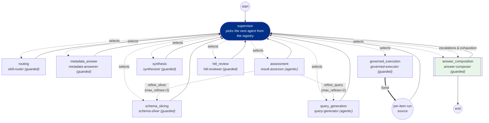
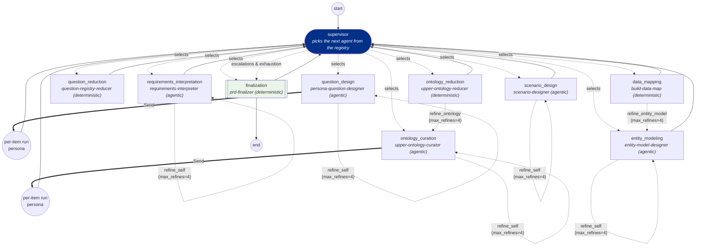

# RAIN Agentic Platform — Restructure & Completion Report

**Date:** 2026-10-21 · **Branch:** `RAIN-intelligence-integration` · **Tests:** 140 green
(`python -m unittest discover -s insights -p "test_*.py" -t .`) · **Static invariants:**
`python -m insights.ci` — all checks passed.

The platform was restructured and finished in one run: two independent skill packs on one shared
runtime, a supervisor orchestrator per pack that picks agents at runtime from the registry, HITL
review with an approve/edit/reject API, per-source fan-out with partial answers, event-driven UI
on both screens, CI-enforced invariants, and a verified live run against the real model and the
real governed database.

---

## 1. Slice status

| Slice | Commit | Delivered |
|---|---|---|
| 0 baseline | `d265852` | Previous session's stage-strip UI + SSE adapter work committed; key backups ignored |
| 1 pack split | `e23a3a4` | `skills/insights/` + `skills/data/`; registry scans both packs, refuses cross-pack deps; manifests carry pack/stage/kind/capabilities; `insights.ci` (pack isolation, gateway-only LLM) |
| 2 spec per skill | `d5eca7e` | Every skill has `agents/<pack>/skills/<name>.yaml`; kind-aware validation (agentic needs a full loop; deterministic may name no model surface) |
| 3 new skills | `c48c9bd` | `synthesizer` + `hitl-reviewer` (guarded); `HitlStore`; typed events `supervisor_decision`, `hitl_waiting`, `hitl_decided`; audited `hitl_decision` |
| 4 insights supervisor | `6568483` | `agents/insights/orchestrator.yaml`; runtime agent selection by capabilities+state; decisions recorded (events + run record); legacy `insights-agent.yaml` removed |
| 5 multi-source | `8768139` | Per-source execution fan-out (Send, branch ids); synthesizer reduces latest attempt, elects a primary execution; partial answers; exhausted refines flow to HITL; two live retrieval/entitlement bugs fixed |
| 6 HITL API | `55a363b` | `GET /v1/hitl/pending`, `POST /v1/hitl/{run_id}` (+ `/api/v2/hitl/...` mirror); timeout → "could not be verified"; HTTP test drives a real held run |
| 7 data supervisor | `aa338a5` | `agents/data/orchestrator.yaml`; PRD runner on the supervisor graph with the same checkpoint/resume; legacy `prd-agent.yaml` removed |
| 8 UI | `5558fef` | Both screens fold the typed event stream: active agent, why picked, tool calls, iterations, loop-backs, fan-out branches, HITL waiting + review bar, per-stage duration/tokens; step names from `graph_definition` only |
| 9 invariants + judge | `c022fc3` | CI: datasource isolation + read-only skills; sliver-never-exceeds-entitlements test; LLM judge on a different model with per-case results |
| 10 live run | `6673f43` | L1 regenerates physical (quoted) table spellings; PG governance applied (36 RLS policies, per-user roles); live NLQ answers end to end |

## 2. Folder tree

```
agents/
  insights/orchestrator.yaml        # NLQ supervisor (capability map, not a sequence)
  insights/skills/<name>.yaml       # one agent spec per insights skill (9)
  data/orchestrator.yaml            # PRD supervisor
  data/skills/<name>.yaml           # one agent spec per data skill (9)
skills/
  insights/   skill-router/ metadata-answerer/ schema-sliver/ query-generator/
              governed-executor/ synthesizer/ result-assessor/ hitl-reviewer/ answer-composer/
  data/       requirements-interpreter/ persona-question-designer/ question-registry-reducer/
              entity-model-designer/ build-data-map/ scenario-designer/
              upper-ontology-curator/ upper-ontology-reducer/ prd-finalizer/
  (each skill = SKILL.md + scripts/run.py shim + its agents/<pack>/skills spec; no runtime edits)
insights/                           # ONE shared runtime, nothing skill-specific
  runtime/    skill_agent.py (bounded plan→tool→observe loop) · tools.py (typed read-only tools)
              supervisor.py (pure agent-selection) · graph.py (the only LangGraph module;
              routed graphs + supervisor graphs + SQLite checkpointer) · hitl.py · engine.py
              events.py · steps.py · stores.py · limits.py
  gateway/    LLMGateway (every model call; per-purpose model groups)
  skills_core/ registry.py (scans BOTH packs; cross-pack deps refused) · contracts
  contracts/  typed events, orchestrator def, run records (incl. supervisor decisions)
  api/        server + HITL endpoints        ci.py  # python -m insights.ci
  prd/        PRD support library + runner (supervisor + checkpoint resume)
  eval/       agentic_golden.py (properties + second-model LLM judge)
```

## 3. Skills table

| Pack | Skill | Stage | Kind |
|---|---|---|---|
| insights | skill-router | routing | guarded |
| insights | metadata-answerer | metadata_answer | guarded |
| insights | schema-sliver | schema_slicing | guarded |
| insights | query-generator | query_generation | agentic |
| insights | governed-executor | governed_execution | guarded (the only path to a data source) |
| insights | synthesizer | synthesis | guarded |
| insights | result-assessor | assessment | agentic |
| insights | hitl-reviewer | hitl_review | guarded |
| insights | answer-composer | answer_composition | guarded (terminal) |
| data | requirements-interpreter | requirements_interpretation | agentic |
| data | persona-question-designer | question_design | agentic (per-persona fan-out) |
| data | question-registry-reducer | question_reduction | deterministic |
| data | entity-model-designer | entity_modeling | agentic |
| data | build-data-map | data_mapping | deterministic |
| data | scenario-designer | scenario_design | agentic |
| data | upper-ontology-curator | ontology_curation | agentic (per-persona fan-out) |
| data | upper-ontology-reducer | ontology_reduction | deterministic |
| data | prd-finalizer | finalization | deterministic (terminal) |

## 4. The two graphs (generated from the YAML by `scripts/orchestrator_mermaid.py`)

Every stage is reached from the supervisor and returns to it — there is no hardcoded sequence.
Dotted `selects` edges are runtime choices by capabilities and state; refine edges are derived
from the skills' declared labels.





## 5. Real-run tokens / time / cost (live model `claude-sonnet-4-6`, live Postgres with RLS)

From `artifacts/real-nlq-run.json` (one run per query type through the insights supervisor):

| Query type | Status | Tokens (prompt+completion) | Wall | Cost* | What happened |
|---|---|---|---|---|---|
| Data query — "How many patients are currently enrolled?" | **answered** (row_count 1, value 1,463) | 4,050 (3,716 + 334) | 9.6 s | ~$0.016 | route → sliver → SQL → governed execute under `SET ROLE insights_maria` with RLS → synthesize → assess (2 bounded refine loops on low coverage) → **HITL hold (low_confidence) approved by reviewer** → answered |
| Metadata — "What tables hold pregnancy episodes?" | **answered** (PregnancyEpisode) | 0 | < 0.1 s | $0 | route → metadata-answerer (catalog, no model, no SQL) → composed |

\*at $3/M input, $15/M output for `claude-sonnet-4-6`.

Supervisor decisions for the data query (as recorded): routing→schema_slicing→query_generation→
governed_execution (fan-out, branch `main`)→synthesis→assessment→(refine_query ×2)→
hitl_review (refines_exhausted → hold → approved)→answer_composition. 73 typed events streamed.

## 6. Eval results (golden set, agent vs single-shot baseline, plus the second-model LLM judge)

Generator: `claude-sonnet-4-6` (strong group). Judge: `claude-haiku-4-5` (fast group) — the judge
refuses to grade if both groups resolve to the same model. Full per-case rows in
`artifacts/agentic-eval/report.json`.

| Suite · mode | Cases | Mean property score | Mean tokens | Mean wall |
|---|---|---|---|---|
| PRD · baseline (single shot) | 5 | 1.00 | 3,814 | 22.8 s |
| PRD · agent (SkillAgent loop) | 5 | 0.96 | 7,403 | 13.9 s |
| NLQ · baseline (single shot) | 8 | 1.00 | 982 | 3.9 s |
| NLQ · agent (SkillAgent loop) | 8 | 1.00 | 1,964 | 3.9 s |

**LLM judge** (`claude-haiku-4-5`, a different model than the generator, per agent case):
12 of 13 agent cases judged — **10 pass / 2 fail, mean score 0.779** (one case returned no
verdict). The two fails are informative, not alarming: `ungroundable` is the case whose CORRECT
agent behaviour is to refuse (label `unusable`, no SQL), which the judge grades as a fail of the
literal task; `elevated-risk` (0.35) flags a real judgment call in how "elevated risk" was mapped
to columns. Per-case verdicts, scores and issues are in the report JSON.

**Whole eval run:** 26 generator cases + 12 judge calls = **94,127 tokens, 246 s wall**, roughly
$0.40 at `claude-sonnet-4-6` rates plus ~$0.02 of judge tokens. The property scores sit at the
ceiling for both arms on these golden cases; the agent arm's advantages (bounded semantic repair,
tool-grounded SQL, honest escalation) show in the hard-path tests and the judge's independent
reading, not in the means.

## 7. Invariants (all enforced by `python -m insights.ci` + tests)

- **Pack isolation** — no file in either pack (code, SKILL.md, specs) references the other;
  registry refuses cross-pack dependencies; no publish step exists between packs.
- **Only governed-executor touches a data source** — no other skill may import
  `insights.datasources`, `psycopg2` or `neo4j` (CI); its four policy layers are deterministic.
- **Synthesizer and assessor never see rows** — summaries and refs only; a `rows` key in the
  synthesizer's input is refused; engine state refuses rows everywhere (`assert_no_rows`).
- **Sliver never exceeds entitlements** — tested for every role, several questions, with
  widening; a role-less principal retrieves nothing.
- **Skills are read-only on disk** (CI); artifacts are written by runners only.
- **All LLM calls go through the gateway** — no `anthropic`/`openai` import outside
  `insights/gateway` across `skills/` and `insights/` (CI).
- **Everything bounded** — SkillAgent iterations/repairs/token budgets, supervisor `max_steps`,
  `max_refines` with downstream invalidation, run deadlines and token budgets, HITL timeout.
- **Typed events only** — `StageEvent` is a closed contract (no free text); supervisor reasons
  are a closed code set; HITL decisions are audited (`hitl_decision`).

## 8. Limitations and honest notes

- The assessor's confidence score is coverage-dominated: questions whose words don't match the
  catalog vocabulary score ~0.27 and routinely end in a HITL hold. That is safe but chatty —
  coverage scoring (or the glossary) deserves tuning.
- `narrate` is disabled in the rain app profile, so answered data queries carry rows and
  confidence but no prose narrative (metadata answers have deterministic narratives). The
  edited-narrative HITL path works regardless.
- The eval's property scores show the baseline at 1.0 on these 13 easy golden cases; the agent
  arm's value shows up in the hard paths (semantic repair, tools, grounding) and in the judge's
  independent verdicts, not in the ceiling-level means.
- The legacy rain-api chat tier (`llm_answer.py`, `sql_generator.py`) still imports the anthropic
  SDK directly — a separate product path, outside the packs and outside the CI scope (which
  covers `skills/` + `insights/`).
- Legacy pytest suites under `skills/insights/*/tests` depend on an `insights_test_support`
  package absent from this checkout; they are not collected by the unittest suite.
- The 2-source NLQ path is exercised with fakes (supervisor fan-out + synthesizer + composer);
  the live app has one Postgres source, so a live 2-source run awaits a second configured source.
- A full real-model PRD run (~900k-token budget) was not re-run this session; the PRD supervisor
  is verified by the full fake-gateway graph tests (fan-out, loop-back, checkpoint resume) and
  PRD Studio replays the recorded events of the last real run.
- HITL holds block a worker thread for the wait's duration — fine at prototype scale, worth an
  async rework under real concurrency.
